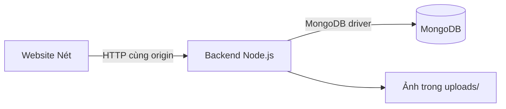

# Thiết kế hiện tại — Node.js và MongoDB

## Kiến trúc

MongoDB là nơi lưu dữ liệu nghiệp vụ. Frontend không giữ mật khẩu hoặc connection string MongoDB. Giao diện bảo tàng giữ thiết kế đã chọn; quản trị mở qua nút “Quản lý tác phẩm”.

## Giao diện nhiều trang

Các mục chính đã tách thành trang HTML riêng: `/`, `/bo-suu-tap/`, `/kham-pha/`, `/cau-chuyen/`, `/tim-kiem/`, `/ve-bao-tang/`. Các chức năng bổ sung cũng có URL riêng: `/quan-ly/`, `/da-luu/`, `/thong-ke/`, `/tac-pham/?id=...`. Menu không còn dùng neo để cuộn tới các khối trên một trang. Chỉ biểu mẫu sửa tác phẩm tiếp tục dùng dialog để giữ ngữ cảnh quản trị.

Nguồn HTML sinh từ `web/layout.mjs`, `web/pages.mjs` và phần editor dùng chung ở `web/partials/`. `npm run build` tạo các `index.html` trong thư mục con của `dist/`. Node backend và máy chủ tĩnh đều phục vụ thư mục này mà không cần SPA fallback. Đường dẫn CSS/JS/ảnh bắt đầu bằng `/` để tải đúng ở mọi trang con.

Trang bộ sưu tập giữ bộ lọc trong URL; chi tiết tác phẩm liên kết trực tiếp tới trang sửa có `?edit=id`. Yêu thích vẫn dùng cùng khóa localStorage từ phiên bản trước, có thể xem ở trang riêng. Tìm bằng ảnh hiện hiển thị tối đa 5 kết quả theo màu sắc. Thống kê chỉ lấy số liệu hồ sơ hiện có, với lượt mở/yêu thích ghi rõ phạm vi trình duyệt.

## Collections

| Collection | Dữ liệu và ràng buộc |
|---|---|
| artworks | id duy nhất, title, author, period, year, category, material, origin, description, tags, imageId, image, sizeBytes, source, license, revision, createdAt, updatedAt |
| media | id duy nhất, URL, định dạng, MIME, dung lượng, kích thước, SHA-256, người tải lên, ngày tạo |
| users | admin có email duy nhất, họ tên, vai trò, passwordHash scrypt; hiện chỉ hỗ trợ một admin |
| sessions | hash token, userId, expiresAt; TTL index để dọn phiên hết hạn |
| collections | mã nhóm nghệ thuật duy nhất và tên hiển thị |
| keywords | tên từ khóa duy nhất |
| audit_logs | tác phẩm, thao tác create/update, quản trị viên, revision, thời điểm |

`artworks.imageId` tham chiếu `media.id`. `sessions.userId`, `media.uploadedBy` và `audit_logs.userId` tham chiếu user. `artworks.tags` là mảng dùng để tìm kiếm; keywords là từ điển được cập nhật khi seed/thêm/sửa. Các tham chiếu này được kiểm tra trong backend; MongoDB không cung cấp FK giống SQL.

ID công khai của 7 tác phẩm cũ được giữ dưới dạng chuỗi, ví dụ `37557`, để các vị trí giới thiệu tiếp tục mở đúng tác phẩm. Tác phẩm mới dùng UUID. `_id` nội bộ do MongoDB quản lý. Không lấy ID hay revision từ đầu vào để chèn tùy ý.

Index: artworks.id unique; artworks(category,year); text index title/author/description/tags; media.id unique; users.email unique; sessions.expiresAt TTL; collections.key và keywords.name unique; audit_logs(artworkId,createdAt).

Hiện gallery lấy catalogue từ API và tìm không dấu bằng JavaScript. Text index được chuẩn bị cho bước tìm kiếm phía server; không tuyên bố frontend hiện đã dùng truy vấn text index. Chưa lưu vector CBIR vào MongoDB.

## API đã thực hiện

| Endpoint | Hành vi |
|---|---|
| GET /api/health | Ping MongoDB |
| GET /api/session | Phiên hiện tại và trạng thái cần thiết lập admin |
| POST /api/auth/setup | Tạo admin đầu tiên; chỉ khi cho phép trong máy chủ cục bộ |
| POST /api/auth/login | Xác thực email/mật khẩu, cấp cookie HttpOnly |
| POST /api/auth/logout | Xóa phiên và cookie |
| GET /api/artworks | Danh sách hồ sơ từ MongoDB |
| GET /api/artworks/:id | Một hồ sơ |
| POST /api/uploads | Admin tải ảnh binary JPG/PNG/WebP; tối đa 8 MB |
| POST /api/artworks | Admin tạo hồ sơ, imageId phải tồn tại |
| PUT /api/artworks/:id | Admin cập nhật hồ sơ với revision hiện tại |

API ghi kiểm tra origin và vai trò trên server. Update dùng allowlist trường và `$set`, không chuyển object đầu vào thành toán tử truy vấn. `findOneAndUpdate` với điều kiện `(id,revision)` và `$inc` để phát hiện xung đột; nếu có chỉnh sửa mới, trả 409 và yêu cầu tải lại trước khi sửa tiếp.

Mật khẩu băm scrypt với salt riêng. Token phiên ngẫu nhiên không lưu plaintext trong MongoDB; lưu SHA-256 và thời hạn 24 giờ. Cookie SameSite=Strict, HttpOnly; Secure khi production. Đăng nhập sai có giới hạn thử theo IP trong tiến trình backend. Thiết lập admin ban đầu bị tắt khi production hoặc máy chủ không bind loopback.

## Upload và lưu ảnh

Client chọn ảnh và xem trước bằng object URL, gửi binary đến backend khi lưu. Backend giải mã bằng sharp, kiểm tra định dạng thực tế, giới hạn số pixel, xoay theo EXIF, resize trong 2000×2000 và chuyển WebP. Tên file UUID do server tạo; không sử dụng tên tệp người dùng để xây đường dẫn.

MongoDB chỉ lưu metadata/URL; ảnh trong `uploads/`. Phải sao lưu cả hai. Upload và ghi hồ sơ là hai bước; khi bỏ biểu mẫu hoặc đổi ảnh có thể còn media chưa tham chiếu. Truy vấn số 14 trong `database/queries.mongodb.js` giúp kiểm tra media đó; chưa có tác vụ tự động xóa. Không tự xóa ảnh đang được tham chiếu.

## Seed và chuyển đổi dữ liệu

Runtime trước đây đọc metadata JSON, chưa có PostgreSQL thực tế để chuyển dữ liệu. 7 hồ sơ nguồn được chuyển sang MongoDB qua `dist/assets/artworks.json` và `initializeDatabase`. `$setOnInsert` chỉ nhập mới, không ghi đè chỉnh sửa. Tất cả script SQL và ERD trước đây giữ ở phần lịch sử; runtime không còn phụ thuộc PostgreSQL.

Không chuyển yêu thích/lượt mở từ trình duyệt sang DB trong đợt này. Những dữ liệu đó vẫn nằm trên thiết bị người dùng, ID số cũ được chuẩn hóa sang chuỗi để giữ tương thích.

## Triển khai

Bản chạy đầy đủ cần Node.js + MongoDB + filesystem/volume bền vững. Có thể dùng MongoDB local hoặc Atlas qua biến môi trường `MONGODB_URI`. Khi sử dụng production cần TLS, cấu hình origin, tắt thiết lập admin và lưu ảnh trên volume/object storage.

Hosting Sites hiện tại chỉ triển khai `dist/`. Nó không có MongoDB hoặc backend Node.js này. Trên hosting tĩnh, catalogue đọc snapshot có nhãn; giao diện quản lý thông báo chưa kết nối, không lưu giả vào localStorage. Để thêm/sửa trên mạng, triển khai cả source Node.js lên host phù hợp; chưa có endpoint backend trực tuyến hoặc MongoDB Atlas được cung cấp trong phiên làm việc.

## Đối chiếu bài tập

Đã có thêm/sửa tác phẩm, ảnh đại diện, đăng nhập admin và kết nối MongoDB thật. Chưa có xóa, nhiều ảnh/video/audio/PDF trên một hiện vật, quản trị nhiều người dùng, bộ đếm tập trung hay đánh giá CBIR có nhãn. MongoDB là thay đổi theo yêu cầu mới; 7 collections và 15 truy vấn MongoDB không tự thay thế yêu cầu “7 bảng quan hệ và 15 SQL” trong tài liệu môn học gốc. Cần trình bày lựa chọn này rõ trong báo cáo và đối chiếu tiêu chí giảng viên.
