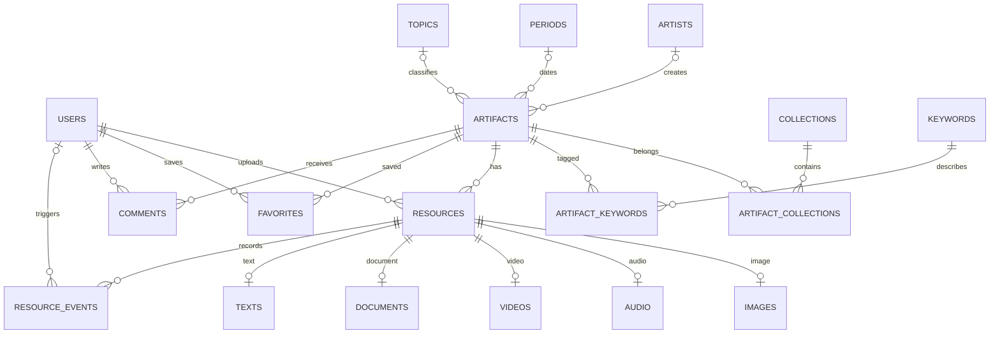

# Định hướng: Nét — Bảo tàng nghệ thuật số

> Tài liệu lịch sử của phiên bản PostgreSQL. Phiên bản hiện tại dùng MongoDB; xem `DINH_HUONG.md`. Các script SQL tương ứng nằm trong `database/legacy-postgresql/` và không được dùng bởi runtime.

## 1. Mục tiêu và giới hạn

Xây dựng hệ thống **quản lý và khai thác tác phẩm nghệ thuật bằng dữ liệu đa phương tiện**. Một tác phẩm liên kết nhiều ảnh, video giới thiệu, audio thuyết minh, tài liệu PDF và metadata. Người xem khám phá tác phẩm; quản trị viên quản lý nội dung và người dùng.

Mỹ thuật là trọng tâm. Khởi đầu với **gốm nghệ thuật Việt**, sau đó mở rộng hội họa, điêu khắc và đồ họa khi có tư liệu đủ quyền sử dụng. Không cần xây dựng tour 3D hoặc chatbot trong phạm vi bắt buộc; ưu tiên CSDL, multimedia và CBIR theo tài liệu bài tập.

## 2. Đối chiếu yêu cầu bài tập

| Yêu cầu | Đã có trong bản mẫu | Phần cần hoàn thiện |
|---|---|---|
| Đăng nhập, Admin/User | Thiết kế bảng users | Đăng nhập, đăng xuất, session và quyền API |
| Quản lý tài nguyên | Bộ dữ liệu ảnh + metadata | CRUD hiện vật/tài nguyên, tải nhiều ảnh, upload server |
| CSDL ≥7 bảng | Script 18 bảng, PK/FK và ERD | Chạy trên PostgreSQL và kết nối API |
| Ảnh, audio, video, PDF, văn bản | Ảnh + mô tả; giọng tổng hợp để thử trải nghiệm | File audio/video/PDF thật, màn hình phát và quản lý |
| Tìm thông thường và nâng cao | Từ khóa, nhóm gốm, niên đại, dung lượng ảnh | Truy vấn API theo loại tệp, tác giả, ngày tạo tài nguyên |
| CBIR | Histogram RGB + cosine trên trình duyệt | Lưu vector trong CSDL, đánh giá có nhãn |
| 15 câu SQL | database/queries.sql | Chạy và ghi kết quả vào báo cáo |
| Thống kê | Dữ liệu mẫu + hoạt động trình duyệt | Sự kiện xem/tải tập trung, biểu đồ theo thời gian |
| 8 màn hình tối thiểu | Trang chủ, tìm kiếm, chi tiết/xem ảnh, thống kê | Đăng nhập, quản lý tài nguyên, quản trị người dùng |
| Hồ sơ bài nộp | Source, SQL, hướng dẫn, dữ liệu ảnh mẫu | Báo cáo 40–60 trang, DB dump, video demo, slide |

## 3. Giao diện và luồng người dùng

Thiết kế theo ảnh tham khảo người dùng cung cấp: header trắng hai hàng, menu chữ hoa gọn, ảnh kiến trúc phủ ngang với tiêu đề đặt trên ảnh, chỉ báo chuyển ba nội dung nổi bật ở cạnh phải; hai khối nội dung trắng chồng lên chân ảnh. Chữ sans-serif và tông trắng–đen giữ không gian trang trọng. Trên điện thoại có menu thu gọn và các khối nội dung xếp một cột. Khu quản trị dự kiến dùng bảng và biểu mẫu rõ ràng.

1. Trang chủ → chọn bộ sưu tập → lọc/tìm → xem hồ sơ → mở ảnh/audio/video/PDF.
2. Tìm bằng ảnh → tải ảnh truy vấn → xem 5 ảnh gần nhất → mở tác phẩm.
3. Đăng nhập Admin → tạo hiện vật → tải nhiều tài nguyên → nhập metadata và kiểm tra → xuất bản.
4. Admin → thống kê → xem tác phẩm được quan tâm và phân bố kho tài nguyên.

## 4. Công nghệ và kiến trúc đề xuất

- Frontend hiện tại: HTML/CSS/JavaScript module để dễ đọc, chạy nhanh, không cần dependency. Có thể chuyển React nếu nhóm đã quen; không bắt buộc chuyển để đạt yêu cầu.
- Backend tiếp theo: **Node.js** để tiếp tục dùng JavaScript ở cả hai phía. Tách tuyến API, lớp nghiệp vụ và lớp truy cập CSDL. Tài liệu: https://nodejs.org/learn/getting-started/introduction-to-nodejs.
- CSDL: **PostgreSQL**, dùng quan hệ, ràng buộc và SQL để thể hiện nội dung môn học. Tài liệu: https://www.postgresql.org/docs/current/tutorial.html.
- File: lưu thư mục riêng trong bản chạy cục bộ; chuyển sang object storage khi triển khai. CSDL lưu metadata và storage_key. Tránh lưu đường dẫn tuyệt đối phụ thuộc máy cá nhân.
- CBIR: giữ chung đặc tả histogram và version giữa trình duyệt/backend; có thể dùng tác vụ xử lý ảnh phía server khi tích hợp upload.

Website mẫu triển khai tĩnh không có PostgreSQL runtime. Bản đầy đủ cần một môi trường chạy backend có thể kết nối PostgreSQL; không thể chỉ thêm connection string vào frontend.

## 5. ERD và quan hệ

18 bảng: users, artists, periods, collections, topics, artifacts, artifact_collections, keywords, artifact_keywords, resources, images, audio, videos, documents, texts, favorites, comments, resource_events. Kiểu dữ liệu, khóa và ràng buộc cụ thể nằm trong `database/schema.sql`.

- **1–1:** resource và bảng chuyên biệt tương ứng; PK resource_id + FK (resource_id,kind) ngăn gắn sai loại. Ở cấp CSDL là 1–0..1; backend phải tạo resource và bản ghi chuyên biệt trong cùng transaction để bảo đảm đúng 1 bản ghi khi xuất bản.
- **1–N:** hiện vật → tài nguyên; thời kỳ → hiện vật; người dùng → tài nguyên tải lên.
- **N–N:** hiện vật ↔ bộ sưu tập, hiện vật ↔ từ khóa, người dùng ↔ hiện vật yêu thích; dùng các bảng nối có khóa chính ghép.
- Niên đại hiện vật khác ngày tạo file. `periods` mô tả niên đại; `resources.created_at` là ngày nhập tệp vào hệ thống.
- Tác giả không rõ để NULL; giao diện ghi “Chưa xác định”. Không tạo tác giả lịch sử giả.

## 6. Lưu file và video lớn

| Tiêu chí | BLOB trong CSDL | File/object storage + metadata |
|---|---|---|
| Nhất quán | Có thể dùng cùng transaction | Cần quy trình xác nhận upload và dọn file mồ côi |
| Sao lưu | Một nơi nhưng DB lớn, backup chậm | Backup DB và file riêng, cần kiểm tra khôi phục đồng bộ |
| Phục vụ media | Qua DB/backend | Có thể dùng HTTP Range, CDN, streaming |
| Video lớn | Tốn dung lượng và I/O CSDL | Upload nhiều phần, stream trực tiếp từ storage |

Chọn **file/object storage + đường dẫn trong CSDL**. File gốc không đi qua JSON/base64. Backend cấp quyền upload, dùng storage_key ngẫu nhiên; xác nhận kích thước, MIME thực tế và checksum trước khi xuất bản. Khi xóa, đánh dấu bản ghi và dọn file sau để xử lý retry.

Với video lớn: upload nhiều phần có tiếp tục, giới hạn dung lượng cấu hình; lưu trạng thái xử lý; tạo thumbnail và HLS trong tác vụ nền; chỉ công bố khi sẵn sàng. MP4 phải hỗ trợ HTTP Range; HLS chia phân đoạn, kết hợp CDN khi cần. Không giữ toàn bộ video trong RAM.

## 7. API dự kiến

| Endpoint | Chức năng | Quyền |
|---|---|---|
| POST /api/auth/login, /logout | Tạo/xóa phiên | Khách / người đăng nhập |
| GET /api/artifacts | query, collection, period, author, kind, maxSize, from, to, page | Công khai với nội dung published |
| GET /api/artifacts/:id | Hồ sơ và tài nguyên | Công khai với nội dung published |
| POST /api/artifacts | Tạo tác phẩm | Admin |
| PATCH, DELETE /api/artifacts/:id | Sửa/xóa | Admin |
| POST /api/uploads, /uploads/complete | Khởi tạo và xác nhận upload | Admin |
| POST /api/search/image | Tìm ảnh CBIR | Người dùng, có giới hạn tần suất |
| GET /api/stats | Số liệu tập trung | Admin |
| GET, POST, PATCH /api/users | Quản trị người dùng | Admin |
| POST, DELETE /api/favorites/:artifactId | Yêu thích | Chủ tài khoản |

Backend phải kiểm tra quyền cho mọi thao tác ghi, hash mật khẩu, dùng truy vấn có tham số, cookie phiên HttpOnly/Secure và bảo vệ CSRF phù hợp. Không xem việc ẩn nút Admin ở frontend là phân quyền. Không lưu mật khẩu hay chuỗi kết nối trong mã trình duyệt.

## 8. CBIR và đánh giá

Pipeline hiện tại: ảnh → resize 96×96 → chia R/G/B thành 4 mức mỗi kênh → histogram chung 4×4×4 = 64 phần tử → chuẩn hóa L1 → cosine similarity → giảm dần. Mã thuật toán: `dist/core.js`; gọi xử lý ảnh và xếp hạng: `dist/app.js`.

Điểm giống màu không đồng nghĩa giống tác phẩm. Phông nền xám của ảnh bảo tàng có thể làm nhiều ảnh giống nhau. Hướng cải tiến: cắt vật thể, thêm đặc trưng kết cấu/hình dạng; so sánh kết quả trước và sau cải tiến.

Thực nghiệm bài nộp: gom khoảng 50–100 ảnh đủ quyền sử dụng, chọn 10–20 ảnh truy vấn, gắn nhãn liên quan trước; đo Precision@5 và thời gian truy vấn. Không dùng ảnh trùng làm kết quả để báo thành tích. Lưu bảng kết quả, ảnh top-5 và trường hợp thất bại vào báo cáo. Vector mẫu SQL để NULL đến khi trích xuất thật; không tạo điểm tương đồng giả.

## 9. Các mốc phát triển

1. **Chốt dữ liệu và thiết kế:** xác nhận nội dung gốm/hội họa/điêu khắc, ERD, use case và dữ liệu có nguồn. Đầu ra: mô hình quan hệ và bộ mẫu.
2. **CSDL và backend:** chạy schema/seed, xác thực hai vai trò, CRUD hiện vật/tài nguyên, kiểm tra quyền và transaction. Đầu ra: API + màn hình quản trị.
3. **Multimedia:** nhiều ảnh/tác phẩm; MP3, MP4, PDF thật; upload, xem/nghe/tải và metadata dung lượng/ngày/tác giả. Đầu ra: luồng quản lý và khai thác hoàn chỉnh.
4. **Tìm kiếm và CBIR:** tích hợp bộ lọc API, vector ảnh, top-5; đánh giá có nhãn. Đầu ra: bảng thực nghiệm.
5. **Thống kê và bàn giao:** sự kiện xem/tải, 15 truy vấn có kết quả, kiểm thử, backup/restore, báo cáo, video 5–10 phút, slide và hướng dẫn cài đặt.

Tiêu chí hoàn thành: đủ 8 màn hình theo đề; dữ liệu còn sau khi khởi động lại; User bị chặn API quản trị; mỗi loại media có mẫu phát được; tìm nâng cao đúng điều kiện; CBIR có phép đo; cài trên máy khác bằng hướng dẫn và file dữ liệu.
